# Projeto ESG — Compliance Ambiental Logtech (API .NET 8 + DevOps)

> **FIAP — Desafio "Navegando pelo mundo DevOps"**
> Aluno: **Eryk Vieira — RM 564801**
> Tema ESG: **Governança e Compliance Ambiental** (Logtech / Comex)
> Base: API RESTful em **C# / .NET 8** desenvolvida nos desafios anteriores (PL/SQL → .NET), agora com pipeline de CI/CD completo, containerização e orquestração de dois ambientes (**staging** e **produção**).

A API monitora a pegada de carbono das operações logísticas de transportadoras, valida licenças ambientais e gera alertas quando o teto mensal de CO₂ é ultrapassado. Toda a entrega da aplicação é automatizada: cada `push` compila, testa, gera uma imagem Docker imutável e a implanta em staging e, após aprovação, em produção.

```
┌──────────┐   ┌──────────┐   ┌──────────────┐   ┌────────────────┐   ┌───────────────────┐
│  build   │─▶│   test   │─▶│ docker→GHCR  │─▶│ deploy STAGING │─▶│ deploy PRODUÇÃO    │
│ .NET 8   │   │  xUnit   │   │ tag = commit │   │ compose :8081  │   │ compose :8082      │
└──────────┘   └──────────┘   └──────────────┘   │ smoke test     │   │ aprovação manual   │
                                                 └────────────────┘   └───────────────────┘
```

---

## Sumário

1. [Como executar localmente com Docker](#-como-executar-localmente-com-docker)
2. [Pipeline CI/CD](#-pipeline-cicd)
3. [Containerização](#-containerização)
4. [Orquestração dos ambientes (staging e produção)](#-orquestração-dos-ambientes-staging-e-produção)
5. [Prints do funcionamento](#-prints-do-funcionamento)
6. [Tecnologias utilizadas](#-tecnologias-utilizadas)
7. [Estrutura do repositório](#-estrutura-do-repositório)
8. [Checklist de entrega](#-checklist-de-entrega)

---

## 🚀 Como executar localmente com Docker

**Pré-requisitos:** Docker Desktop (ou Docker Engine 24+) com Docker Compose v2. Nenhum SDK .NET é necessário — o build acontece dentro do container.

```bash
# 1) clone o repositório
git clone https://github.com/eryk-vieira/compliance-ambiental-devops.git
cd compliance-ambiental-devops

# 2) crie o arquivo de variáveis de ambiente a partir do exemplo
cp .env.example .env

# 3) suba API + SQL Server (primeira vez: ~2-4 min, baixa imagens e compila)
docker compose up --build -d

# 4) acompanhe o startup (migrations EF Core + seed automáticos)
docker compose logs -f api
```

Quando o container `compliance-dev-api` estiver `healthy`:

| Recurso | URL |
|---|---|
| Swagger UI | http://localhost:8080/swagger |
| Health (readiness: API + banco) | http://localhost:8080/health/ready |
| Health (liveness) | http://localhost:8080/health/live |
| Informações do ambiente/versão | http://localhost:8080/api/info |

Autenticação (usuários criados pelo seed): `admin / Admin@123` (Admin) e `auditor / Auditor@123` (Auditor).

```bash
# login e chamada autenticada
TOKEN=$(curl -s -X POST http://localhost:8080/api/auth/login \
  -H 'Content-Type: application/json' \
  -d '{"login":"admin","senha":"Admin@123"}' | sed -n 's/.*"accessToken":"\([^"]*\)".*/\1/p')

curl -s http://localhost:8080/api/emissoes/alertas -H "Authorization: Bearer $TOKEN" | jq
```

Smoke test completo contra qualquer ambiente (o mesmo usado pelo pipeline):

```bash
bash scripts/smoke-test.sh http://localhost:8080 development
```

Para parar: `docker compose down` (mantém o volume do banco) ou `docker compose down -v` (apaga tudo).

### Subindo staging e produção localmente

Os dois ambientes podem coexistir na mesma máquina (portas, redes, volumes e bancos distintos):

```bash
cp .env.staging.example .env.staging
cp .env.production.example .env.production

bash scripts/deploy.sh staging --build      # http://localhost:8081
bash scripts/deploy.sh production --build   # http://localhost:8082

bash scripts/deploy.sh staging --down       # derruba o ambiente
```

---

## 🔁 Pipeline CI/CD

**Ferramenta:** GitHub Actions — workflow em [`.github/workflows/ci-cd.yml`](.github/workflows/ci-cd.yml).
**Registro de imagens:** GitHub Container Registry (GHCR) — `ghcr.io/eryk-vieira/compliance-ambiental-api`.
**Ambientes:** GitHub *Environments* `staging` e `production` (o de produção com *required reviewers*, ou seja, aprovação manual antes do deploy).

### Gatilhos

| Evento | O que roda |
|---|---|
| `pull_request` para `main` | build + testes (sem gerar imagem nem deploy) |
| `push` em `develop` | build + testes + imagem Docker + **deploy em staging** |
| `push` em `main` | tudo acima + **deploy em produção** (após aprovação) |
| `workflow_dispatch` | execução manual pela interface do GitHub |

### Etapas (jobs)

| # | Job | O que faz | Saídas |
|---|---|---|---|
| 1 | **build** | `dotnet restore` → `dotnet build -c Release` → `dotnet publish`. Cache de pacotes NuGet. Gera a versão `1.0.<run_number>+<sha>`. | artefato `api-publish-<sha>` |
| 2 | **test** | `dotnet test` da solução (xUnit + `WebApplicationFactory` + EF Core InMemory — 15 testes: 1+ por controller, autorização, regras de negócio, health checks). Publica relatório TRX como *check* no commit e cobertura (coverlet). | artefato `test-results-<sha>` |
| 3 | **docker** | `docker buildx build` multi-stage com cache do GitHub e `push` para o GHCR. Tags: `sha-<commit>` (imutável), `<branch>`, `build-<n>`. `build-args` injetam versão/commit na imagem (labels OCI + `/api/info`). | imagem no GHCR |
| 4 | **deploy-staging** | Environment `staging`. Gera `.env.staging` a partir de *secrets/variables*, executa `scripts/deploy.sh staging`: `docker pull` → `docker compose -f docker-compose.staging.yml up -d --wait` → **smoke test** (readiness, `/api/info` = `staging`, 401 sem token, login JWT, 7 endpoints de negócio). Coleta evidências e **promove** a imagem para a tag `:staging`. | artefato `evidence-staging-<sha>` |
| 5 | **deploy-production** | Só em `main` e após o sucesso do staging. Environment `production` (aguarda aprovação manual). Mesmo fluxo com `docker-compose.production.yml` (porta 8082, banco não exposto, limites de recursos). Promove a **mesma imagem** para `:production` e `:latest`. | artefato `evidence-production-<sha>` |

### Lógica e boas práticas aplicadas

- **Build once, deploy many:** a imagem é construída uma única vez (tag = commit) e *promovida* entre ambientes por re-tag (`docker buildx imagetools create`). Staging e produção rodam exatamente o mesmo binário.
- **Quality gate:** nenhuma imagem é gerada se o build ou os testes falharem; nenhum deploy em produção acontece se o smoke test de staging falhar.
- **Configuração por ambiente fora da imagem:** connection string, segredo JWT, portas e nomes de banco vêm de `.env.<ambiente>` (local) ou dos *secrets/variables* do environment (CI). A imagem é idêntica.
- **Deploy verificado:** `compose up --wait` aguarda os *healthchecks* do SQL Server e da API; o smoke test só passa se `/api/info` reportar o ambiente esperado e os endpoints autenticados responderem 200. Falha → job vermelho → produção não é acionada.
- **Evidências automáticas:** cada deploy salva `docker compose ps`, imagens, redes, volumes, labels, logs e respostas da API em `evidence/<ambiente>/`, publicados como artefatos e no *Job Summary*.
- **Ambientes efêmeros no runner:** ao final de cada job o compose é derrubado (`down -v`), deixando o runner limpo. O mesmo `scripts/deploy.sh` funciona em um servidor real (VM/self-hosted runner) sem alteração.

---

## 🐳 Containerização

### Dockerfile

```dockerfile
# Estágio 1: build (SDK completo) ------------------------------------------
FROM mcr.microsoft.com/dotnet/sdk:8.0 AS build
WORKDIR /src
COPY ComplianceAmbiental.sln ./
COPY src/ComplianceAmbiental.Api/ComplianceAmbiental.Api.csproj src/ComplianceAmbiental.Api/
COPY tests/ComplianceAmbiental.Tests/ComplianceAmbiental.Tests.csproj tests/ComplianceAmbiental.Tests/
RUN dotnet restore ComplianceAmbiental.sln          # camada cacheada
COPY . .
RUN dotnet publish src/ComplianceAmbiental.Api/ComplianceAmbiental.Api.csproj \
    -c Release -o /app/publish --no-restore /p:UseAppHost=false

# Estágio 2: runtime (apenas ASP.NET Runtime) ------------------------------
FROM mcr.microsoft.com/dotnet/aspnet:8.0 AS runtime
ARG APP_VERSION=dev
ARG APP_COMMIT_SHA=local
ARG APP_BUILD_NUMBER=local
ARG BUILD_DATE=unknown
LABEL org.opencontainers.image.title="compliance-ambiental-api" \
      org.opencontainers.image.version="${APP_VERSION}" \
      org.opencontainers.image.revision="${APP_COMMIT_SHA}" \
      org.opencontainers.image.created="${BUILD_DATE}"
RUN apt-get update && apt-get install -y --no-install-recommends curl ca-certificates \
    && rm -rf /var/lib/apt/lists/*
WORKDIR /app
COPY --from=build /app/publish .
ENV ASPNETCORE_URLS=http://+:8080 ASPNETCORE_ENVIRONMENT=Production \
    APP_VERSION=${APP_VERSION} APP_COMMIT_SHA=${APP_COMMIT_SHA} APP_BUILD_NUMBER=${APP_BUILD_NUMBER}
EXPOSE 8080
USER app                                            # usuário não-root
HEALTHCHECK --interval=15s --timeout=5s --start-period=40s --retries=5 \
    CMD curl -fsS http://localhost:8080/health/ready || exit 1
ENTRYPOINT ["dotnet", "ComplianceAmbiental.Api.dll"]
```

(Arquivo completo e comentado: [`Dockerfile`](Dockerfile).)

### Estratégias adotadas

| Estratégia | Benefício |
|---|---|
| **Multi-stage build** (SDK → Runtime) | Imagem final ~220 MB em vez de ~900 MB; sem compilador nem código-fonte em produção. |
| **Restore em camada separada** (copia só `.sln`/`.csproj` antes do código) | Rebuilds só baixam pacotes NuGet quando as dependências mudam → builds muito mais rápidos. |
| **`.dockerignore`** (bin/obj, docs, .git, .env, compose) | Contexto de build pequeno e nenhum segredo copiado para a imagem. |
| **Usuário não-root (`USER app`)** | Reduz o impacto de uma eventual exploração do container. |
| **`HEALTHCHECK` embutido** chamando `/health/ready` | Docker/compose sabem quando a API está realmente pronta (processo + banco); `depends_on: service_healthy` e `--wait` passam a funcionar. |
| **Metadados OCI via `build-args`** (versão, commit, data) | Rastreabilidade: `docker inspect` e `/api/info` dizem exatamente qual commit está rodando. |
| **Configuração 100% por variáveis de ambiente** (`ConnectionStrings__DefaultConnection`, `Jwt__SecretKey`, `APP_ENVIRONMENT`…) | Mesma imagem em dev, staging e produção (12-factor). |
| **Cache de camadas no CI** (`cache-from/to: type=gha`) | Build da imagem no pipeline cai de minutos para segundos quando só o código muda. |

### Imagem gerada

`ghcr.io/eryk-vieira/compliance-ambiental-api` com as tags `sha-<commit>` (imutável), `<branch>`, `build-<n>`, `staging`, `production` e `latest`.

---

## 🧩 Orquestração dos ambientes (staging e produção)

Três arquivos Compose, um por ambiente, compondo **API + SQL Server 2022** com **volumes**, **redes** e **variáveis de ambiente** próprios:

| | `docker-compose.yml` (dev) | `docker-compose.staging.yml` | `docker-compose.production.yml` |
|---|---|---|---|
| Projeto compose | `compliance-dev` | `compliance-staging` | `compliance-production` |
| Porta da API | 8080 | **8081** | **8082** |
| Porta do banco no host | 1433 | 14331 | **não exposta** (`expose` interno) |
| `ASPNETCORE_ENVIRONMENT` | Development | **Staging** | **Production** |
| Banco de dados | `ComplianceAmbiental` | `ComplianceAmbiental_Staging` | `ComplianceAmbiental` |
| Volume | `mssql-data` | `mssql-data-staging` | `mssql-data-production` |
| Rede | `compliance-net` | `compliance-staging-net` | `compliance-prod-net` |
| Imagem | build local | `ghcr.io/...:sha-<commit>` | mesma imagem promovida |
| Extras | — | — | limite de memória, rotação de logs, `restart: always` |

Pontos comuns: `healthcheck` do SQL Server via `sqlcmd`, `depends_on: condition: service_healthy`, segredos vindos de `.env.<ambiente>` (`:?` obriga a definição em staging/prod) e `MSSQL_MEMORY_LIMIT_MB` para rodar em runners pequenos.

Scripts de apoio em [`scripts/`](scripts/):

- `deploy.sh <staging|production> [--build] [--down]` — carrega o `.env`, faz `pull`/`build`, `up -d --wait` e executa o smoke test.
- `smoke-test.sh <url> [ambiente]` — valida readiness, `/api/info`, autenticação JWT e endpoints de negócio; sai com erro se algo falhar.
- `collect-evidence.sh <ambiente>` — grava `ps`, imagens, redes, volumes, labels, logs e respostas em `evidence/<ambiente>/`.

---

## 📸 Prints do funcionamento

Repositório: **https://github.com/eryk-vieira/compliance-ambiental-devops**
Execução de referência do pipeline (commit `47a7b75`, branch `main`, status **Success**, 10m30s):
**https://github.com/eryk-vieira/compliance-ambiental-devops/actions/runs/38490906947**
Imagem publicada: **https://github.com/eryk-vieira/compliance-ambiental-devops/pkgs/container/compliance-ambiental-api**
Histórico de deployments: **https://github.com/eryk-vieira/compliance-ambiental-devops/deployments**

As evidências textuais completas (`/api/info`, smoke tests e `docker compose ps` de cada ambiente) estão em [`docs/evidencias/run-2-summary.md`](docs/evidencias/run-2-summary.md). Os artefatos `evidence-staging-47a7b75` e `evidence-production-47a7b75` (logs dos containers, respostas da API, swagger) ficam anexados à execução no GitHub.

### 1. Pipeline completo (build → test → docker → staging → produção)

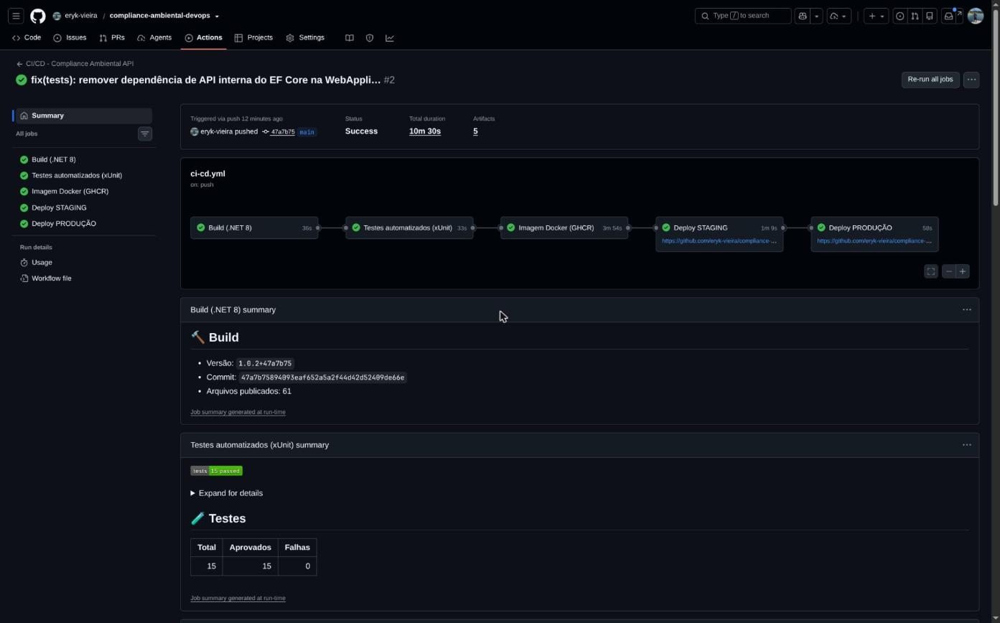

### 2. Build (.NET 8) — `Build succeeded. 0 Warning(s) 0 Error(s)`

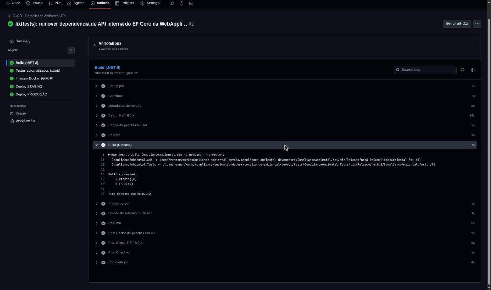

### 3. Testes automatizados — `Test Run Successful. Total tests: 15 Passed: 15`

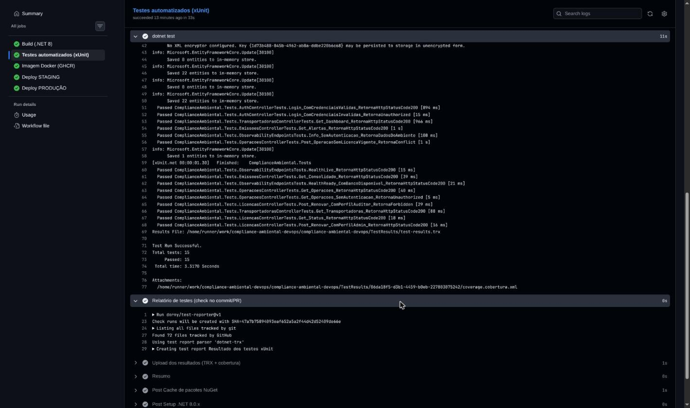

### 4. Imagem Docker publicada no GHCR (`sha-47a7b75`, `main`, `build-2`)

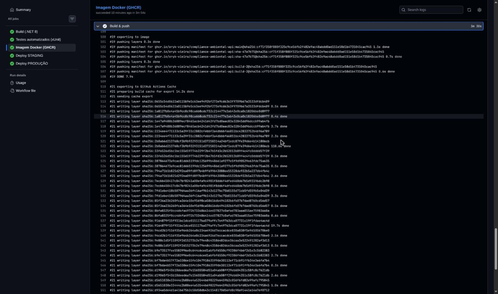

### 5. Deploy em STAGING — `docker compose up`, `/api/info` com `"ambiente":"staging"` e smoke test 12/12

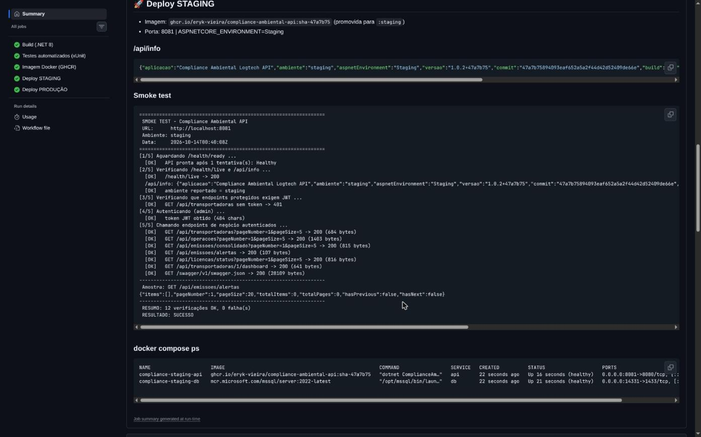

### 6. Pacote no GHCR com as tags promovidas (`staging`, `production`, `latest`)

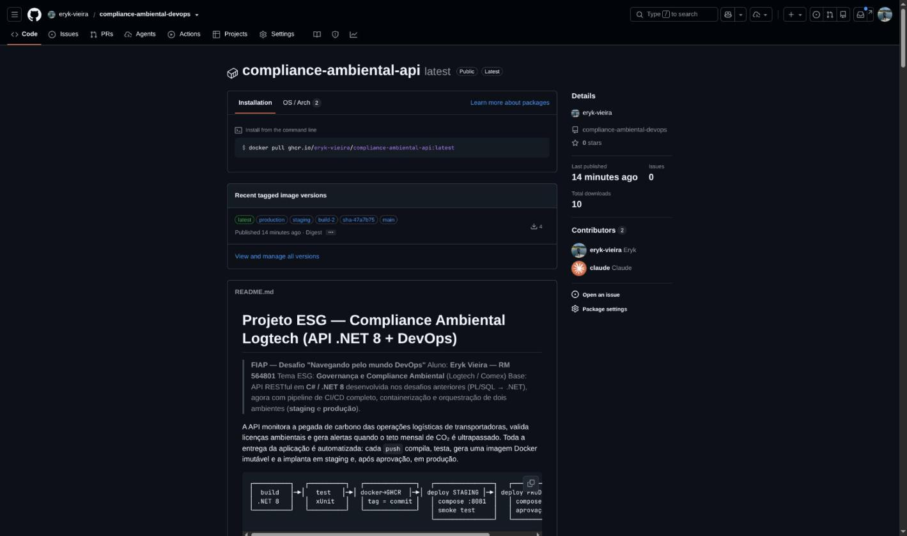

### 7. Produção aguardando aprovação manual (environment `production` com *required reviewers*)

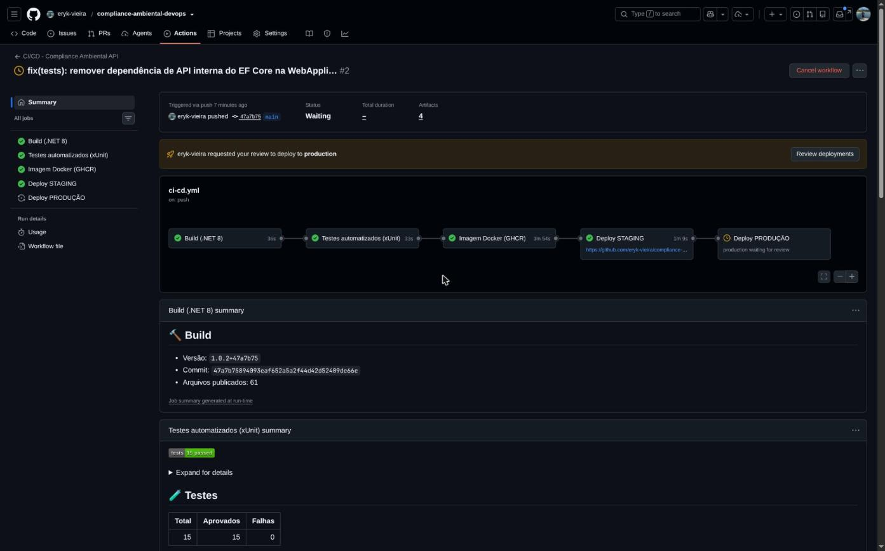

### 8. Deploy em PRODUÇÃO — `/api/info` com `"ambiente":"production"` e smoke test 12/12

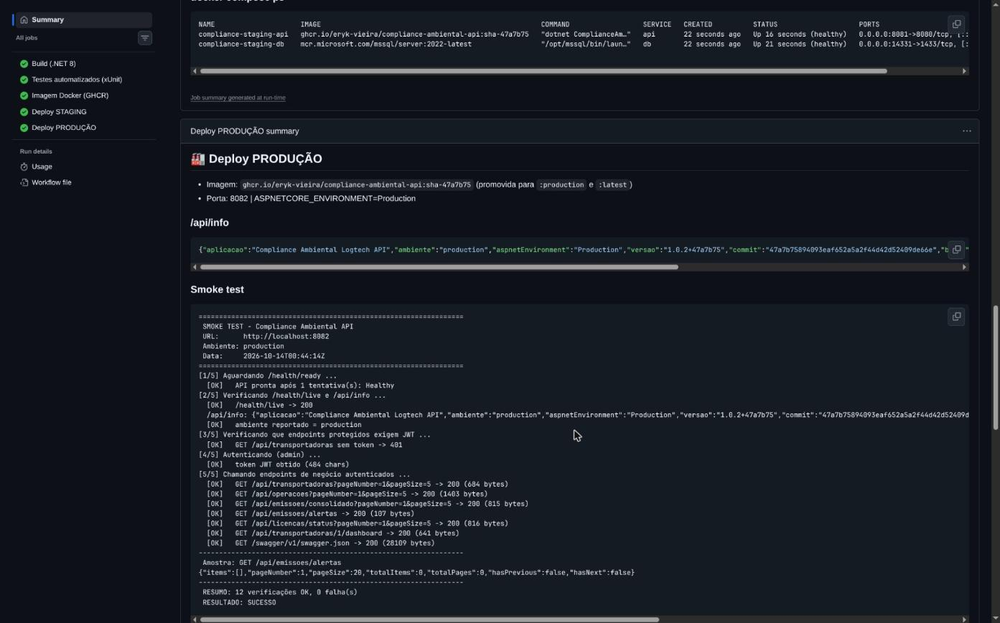

### 9. Containers de produção (`healthy`, banco sem porta exposta) e registro da aprovação

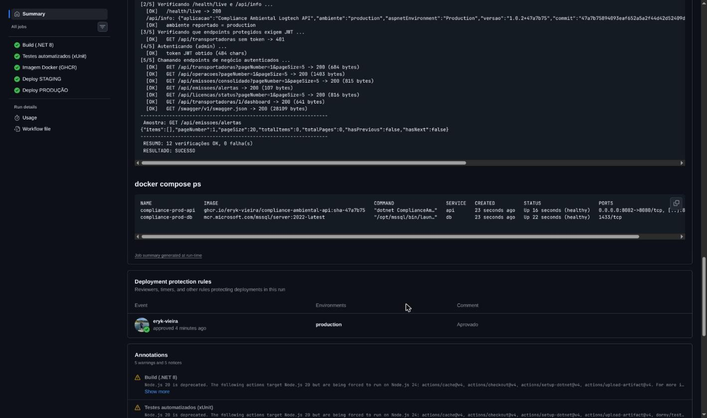

### 10. Histórico de deployments nos dois ambientes

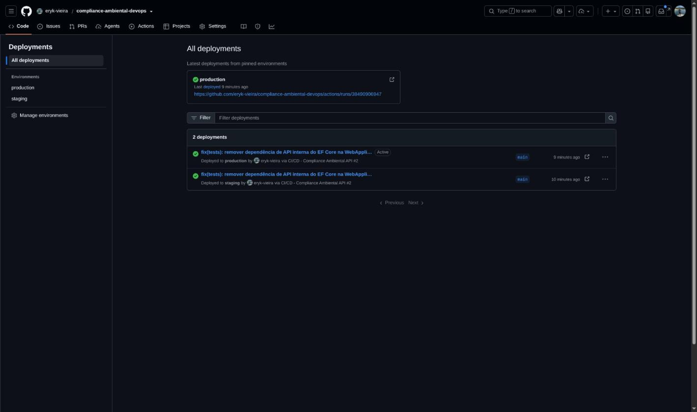

### 11. Histórico de execuções (1ª execução falhou no build → correção → 2ª execução verde)

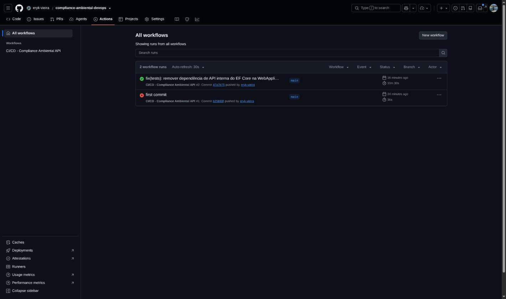

---

## 🛠 Tecnologias utilizadas

| Categoria | Tecnologias |
|---|---|
| Linguagem / framework | C# 12, .NET 8, ASP.NET Core Web API |
| Persistência | Entity Framework Core 8 (migrations + seed), SQL Server 2022 (container `mcr.microsoft.com/mssql/server`) |
| Segurança | JWT Bearer (`Microsoft.AspNetCore.Authentication.JwtBearer`), hashing de senha, autorização por perfil |
| Qualidade | xUnit, `Microsoft.AspNetCore.Mvc.Testing` (WebApplicationFactory), EF Core InMemory, coverlet, FluentValidation |
| Observabilidade | ASP.NET Core Health Checks (`/health/live`, `/health/ready`), endpoint `/api/info`, Swagger / OpenAPI (Swashbuckle) |
| Containerização | Docker (multi-stage, non-root, HEALTHCHECK, labels OCI), Docker Compose v2 (3 ambientes) |
| CI/CD | GitHub Actions (jobs, environments com aprovação, artifacts, job summary, cache NuGet e Buildx), GitHub Container Registry |
| Automação | Bash (`deploy.sh`, `smoke-test.sh`, `collect-evidence.sh`), curl |

---

## 📁 Estrutura do repositório

```
compliance-ambiental-devops/
├── .github/workflows/ci-cd.yml          # pipeline CI/CD (5 jobs)
├── Dockerfile                           # multi-stage, non-root, healthcheck
├── .dockerignore
├── docker-compose.yml                   # ambiente local/dev
├── docker-compose.staging.yml           # ambiente de staging (porta 8081)
├── docker-compose.production.yml        # ambiente de produção (porta 8082)
├── .env.example / .env.staging.example / .env.production.example
├── scripts/
│   ├── deploy.sh                        # deploy + smoke test de um ambiente
│   ├── smoke-test.sh                    # validação funcional pós-deploy
│   └── collect-evidence.sh              # coleta de evidências
├── src/ComplianceAmbiental.Api/         # API (.NET 8, MVVM)
├── tests/ComplianceAmbiental.Tests/     # testes xUnit
├── postman/                             # coleção Postman
├── docs/
│   ├── Documentacao_Tecnica_DevOps.pdf  # documentação técnica com evidências
│   ├── prints/                          # 11 capturas do pipeline e ambientes
│   └── evidencias/                      # saídas coletadas pelo pipeline (run-2-summary.md)
├── ComplianceAmbiental.sln
└── README.md
```

---

## ✅ Checklist de entrega

| Item | OK |
|---|:---:|
| Projeto compactado em .ZIP com estrutura organizada | ☑ |
| Dockerfile funcional | ☑ |
| docker-compose.yml ou arquivos Kubernetes | ☑ (3 arquivos compose: dev, staging, production) |
| Pipeline com etapas de build, teste e deploy | ☑ (GitHub Actions — 5 jobs) |
| README.md com instruções e prints | ☑ |
| Documentação técnica com evidências (PDF ou PPT) | ☑ (`docs/Documentacao_Tecnica_DevOps.pdf`) |
| Deploy realizado nos ambientes staging e produção | ☑ (jobs `deploy-staging` e `deploy-production`) |
